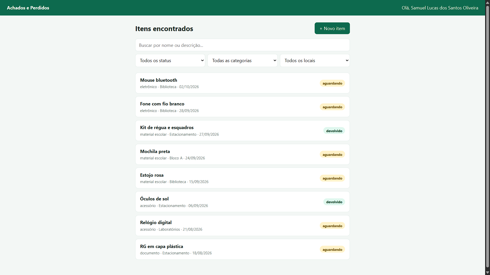
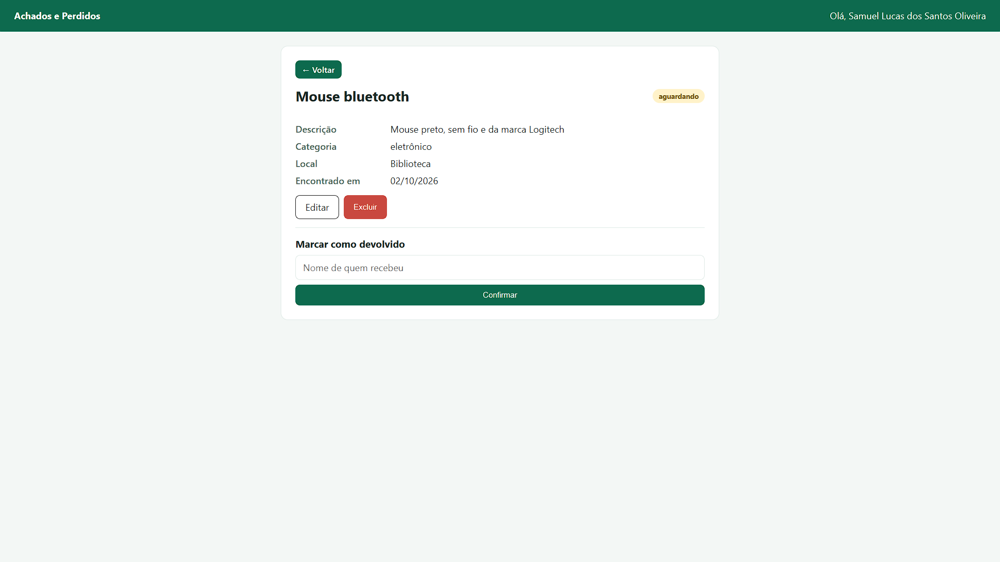
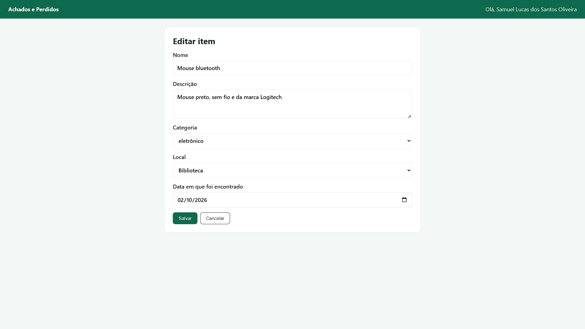
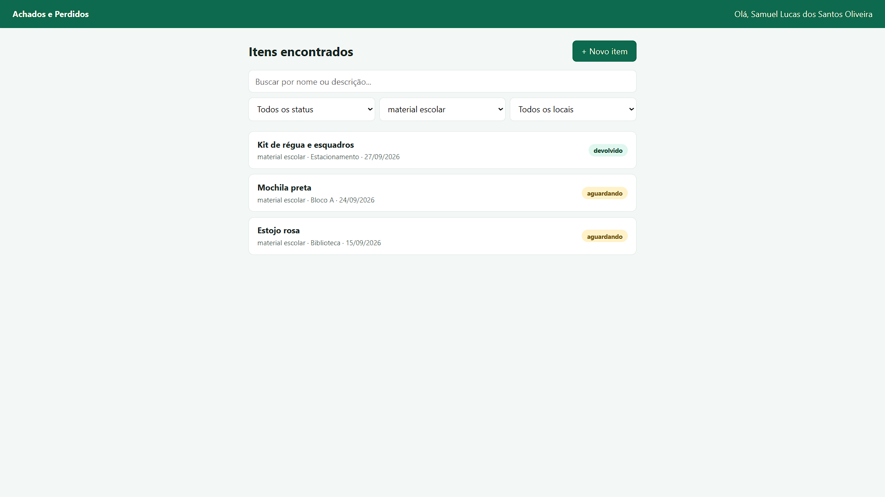
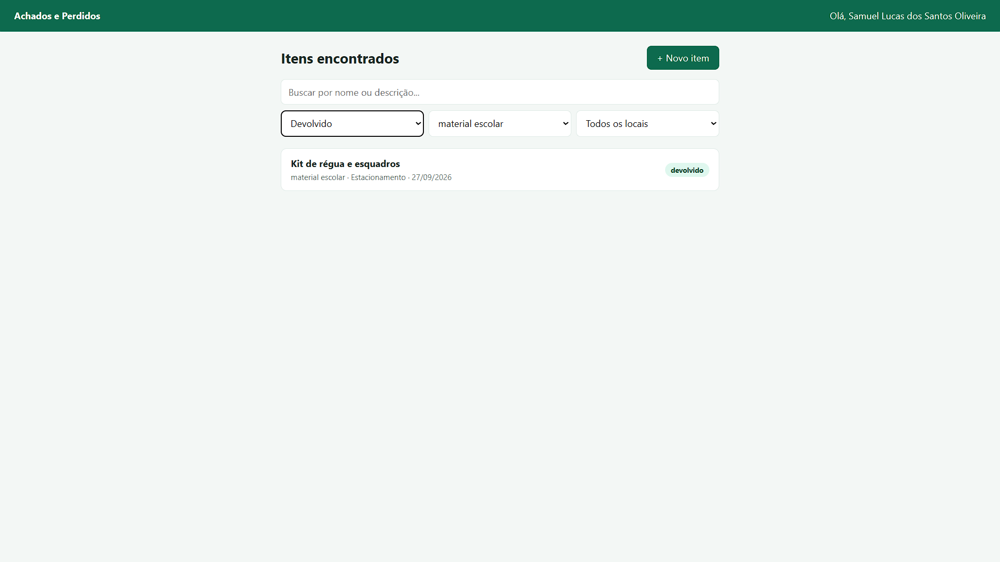
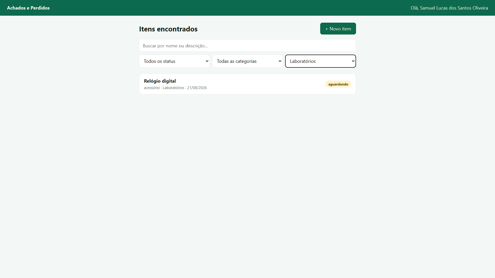
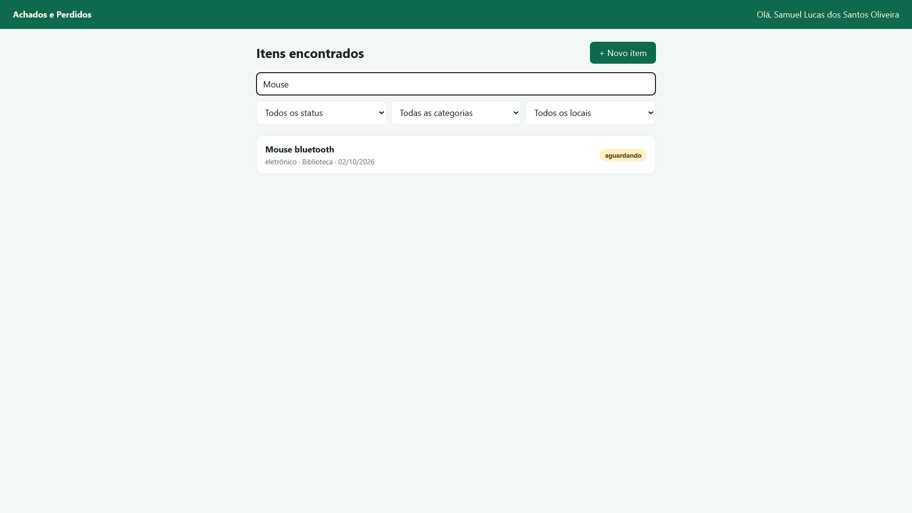

# Front-end do Achados e Perdidos IFRN

Front-end em React + Vite que consome a API de Achados e Perdidos do campus.

## Funcionalidades
Listagem com busca e filtros, detalhes, cadastro, edição, devolução e exclusão com confirmação.

## Tela inicial

## Tela ao clicar no item

## Tela de edição do item

## Teste de filtros e pesquisa

